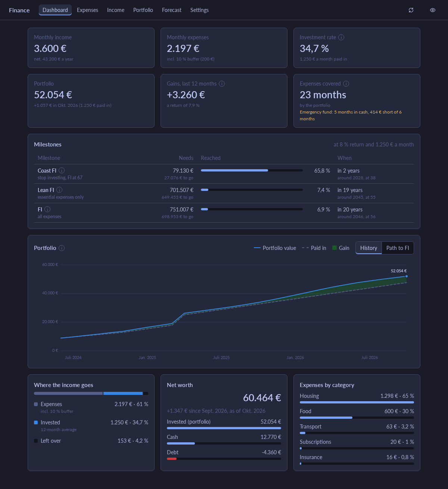
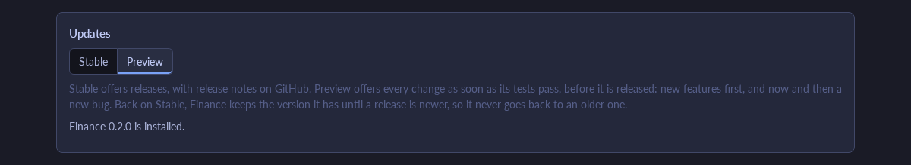
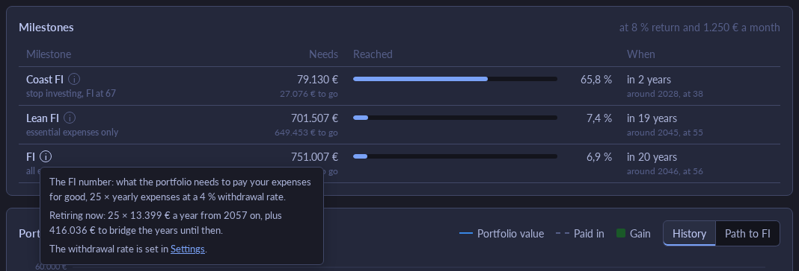

# Finance

A personal finance dashboard for [Omarchy](https://omarchy.org/): regular
expenses and income, the monthly values of your accounts, and the numbers
that matter on the way to financial independence (FI), with a forecast of
how your portfolio could grow and whether it lasts, a state pension
included. No account and no sync: everything stays in one file on this
computer.

It runs as an Omarchy web app: a small local server and a "Finance" window
in the app launcher. Colors follow the current Omarchy theme; the charts
keep colors of their own, so that their lines stay apart in every theme.



## Install

Needs Omarchy (tested with 4.5.0), Python 3.11 or newer, and Chromium
(Omarchy's default browser).

```bash
git clone https://github.com/simonmcschubert/omarchy-finance.git ~/.local/share/omarchy-finance
~/.local/share/omarchy-finance/setup
```

`setup` adds a user service (`omarchy-finance.service`) that runs the server
at login on `http://127.0.0.1:47219/`, and a "Finance" entry in the app
launcher (`Super+Space`). The server reads the code from the cloned
directory, so keep it where it is.

## Update

Finance looks for a new release 15 seconds after its server starts and every
four hours. The update button, a circle of arrows at the right end of the top
bar, checks now when clicked; hover it to see the installed version. When
there is a release, the button turns into a down arrow with **Update**. Click
it to download the release, then click **Restart to update** to install it:
Finance restarts its server with the release and reloads the window. When the
new server does not answer, Finance goes back to the version it had. A
notification confirms the update or says why it failed. When it fails before
the restart (local changes in the checkout, for example), the button says
**Update failed** and why, when hovered. Like `git pull`, this does not show
the changes first; the release notes on GitHub list them. Updates never touch
the data.


Settings › Updates chooses which updates the button offers. **Stable**, the
default, offers releases. **Preview** offers every change on `main` as soon
as CI has passed for it, days or weeks before it is released: new features
first, and now and then a new bug. A preview is named by its commit, such as
`preview 1a2b3c4`, and the installed version then reads `0.2.0-3-g1a2b3c4`:
three commits past 0.2.0. Previews have no release notes; the commits on
GitHub list the changes. Back on Stable, Finance keeps the version it has
until a release is newer. It never goes back to an older version, which
could not read data saved by a newer one.



Looking for updates asks the repository Finance was cloned from (GitHub) for
its tags, and on Preview for its `preview` branch. Nothing about the data is
sent.

The same from a terminal:

```bash
~/.local/share/omarchy-finance/update check
~/.local/share/omarchy-finance/update install 0.2.0
~/.local/share/omarchy-finance/update channel preview   # or stable
```

`git -C ~/.local/share/omarchy-finance pull && ~/.local/share/omarchy-finance/setup`
works too, and is how a copy installed before the update button gets it. It
takes the newest commit on `main`, released or not. Run `setup` again after
an update when the release notes say so, for changes to the service or the
launcher entry.

## Remove

```bash
~/.local/share/omarchy-finance/setup --remove
rm -rf ~/.local/share/omarchy-finance
```

The data file stays.

## Use

- **Dashboard**: the numbers on the way to FI, the milestones (Coast FI,
  Lean FI and FI), the portfolio's history or its path to FI, the net
  worth, and where the income goes. See
  [Dashboard numbers](#dashboard-numbers).
- **Expenses** and **Income**: regular payments, from now or a month to
  come, until they end. See [Expenses and income](#expenses-and-income).
- **Portfolio**: each account's value at the end of each month, and what
  was paid in, with the returns and the history. See
  [Portfolio, net worth and returns](#portfolio-net-worth-and-returns).
- **Forecast**: how the portfolio could grow until retirement, and whether
  it lasts after, in three plans and at three growth rates (6, 8 and 10 % a
  year before inflation, by default), with planned one-offs. See
  [Forecast](#forecast).
- **Settings**:
  - Currency (default euro). It only changes how amounts are shown; nothing
    is converted.
  - Number format for amounts and percentages: `1.000.000,00` (default),
    with the currency sign after the amount (`1.234,56 €`), or
    `1,000,000.00`, with it before (`€1,234.56`). Amounts can be typed
    either way. Dates follow the system language.
  - Safe withdrawal rate (default 4 %) and a buffer on expenses for irregular
    costs (default 10 %).
  - Expected return (default 8 %): the portfolio's yearly return before
    inflation, for Time to FI, the Path to FI chart and the forecast.
  - Inflation (default 3 %): how much prices rise a year. Time to FI, the
    Path to FI chart and the forecast raise the expenses and the FI number
    by it, so their amounts are in the money of each year. Pay-ins stay as
    they are (see Future pay-in). Data files from before this setting get
    3 % inflation and 3 points more expected return, so 5 % after inflation
    becomes 8 % before it.
  - Future pay-in: what you pay in a month from now on, for the investment
    rate, the milestones, the Path to FI chart and the forecast. Either the
    average pay-in of the last 12 months (default), which follows your
    pay-ins as you enter them, or an amount of your own, for a change you
    know is coming, such as a raise or paying in less after Coast FI. It
    stays the same every month: inflation does not raise it.
  - Year of birth and the official retirement age (default 67: when the
    state pension starts without deductions, not when you plan to stop
    working), for the forecast. The forecast needs the year of birth; it is
    empty until entered. Ages and retirement start in January of their year.
  - Emergency fund (default 6): how many months of expenses to keep in
    cash accounts; 0 sets no target.
  - Categories, one list for expenses and one for income. A new data file
    starts with a few common ones. Renaming a category renames it on every
    expense or income that has it; deleting one leaves them without a
    category.
  - Accounts, each with what it holds; see
    [Portfolio, net worth and returns](#portfolio-net-worth-and-returns).
    Deleting one deletes its monthly values too.
  - Import past months from CSV, and export all monthly values as CSV.
  - Where the data file and its daily backups are, and which updates to
    offer.

The pages keep their text short. An ⓘ next to a number, a column or a field
explains it: what it means, how it is worked out, and what is assumed. Click
it, or press Enter on it, to open it; Esc or a click elsewhere closes it.



`Ctrl+1` to `Ctrl+6` open Dashboard, Expenses, Income, Portfolio, Forecast and
Settings. `Ctrl+Shift+H`, or the eye at the right end of the top bar, hides
every amount (as `••• €`, in charts and amount fields too) and keeps the
percentages, for sharing the screen; again shows them. The choice is kept in
this browser.

### Expenses and income

Each expense and income has a name, a category, an amount, and how often it
is paid, in months (1 monthly, 3 quarterly, 12 yearly, 24 every two years,
or any other number up to 120). Enter income after tax. Only current
amounts: when the rent goes up, edit it and the numbers change.

- **Starts** now, at retirement, at an age or in a month, and **ends**
  never, at retirement, at an age or after a month: childcare from August
  2027 until July 2031, health insurance from retirement until 67, a state
  pension from 67, a salary until retirement. It counts only in its
  months: what does not count this month is listed under Later or Ended,
  and is left out of the totals. In the forecast, retirement is each plan's
  own (for Retire early, the month after FI). New income ends at
  retirement; new expenses never end. Income from before starts and ends
  ends at retirement, as it was never counted after it; change that for
  income that goes on, such as rent from a flat.
- **Essential** marks an expense you would pay even on the leanest budget
  (rent, food, insurance): those count for Lean FI as well. New expenses
  are not essential.
- **Deactivate** sets an expense inactive: it stays in the list, under
  Inactive, but counts nowhere (not in the totals, the FI number or the
  charts) until **Activate** counts it again.


Two helpers, for Germany, at the bottom of the pages, add what changes when
you stop working:

- **State pension** (under Income): your Rentenpunkte so far, from the
  Renteninformation, plus those of the years you still plan to work,
  times the value of a point (42,52 € from July 2026), 0,3 % less a month
  before the regular age (your retirement age in Settings; at most 4
  years) or 0,5 % more a month after it, less what pensioners pay for
  health and care insurance (12,95 % by default). Added as the income
  "State pension" from the age it starts, or updates it. The
  Renteninformation's own pension at 67 assumes you pay in until then;
  early retirees get less.
- **Health and care insurance after you stop working** (under Expenses):
  as a voluntary member of a statutory insurer, at least the minimum base
  (1.318,33 € a month in 2026) × 14 % + the Zusatzbeitrag (2,9 % on
  average) + care insurance (4,2 % without children, 3,6 % with): about
  280 € a month. Added as the essential expense "Health and care
  insurance" from retirement until the age the pension starts.

Both numbers can be changed; income tax is left out.


### Portfolio, net worth and returns

Each account holds something: **invested** (brokers, ETF savings plans:
the portfolio), **cash** (Tagesgeld, the emergency fund), **property**,
**pension assets** (Riester, Rürup, a company pension: locked until
retirement) or **debt** (what is still owed, such as a mortgage). Only
invested accounts are the portfolio that the FI number, Time to FI and the
forecast count; all of them, debts taken off, are the net worth. Accounts
are set up in Settings; those from before kinds, and new ones from a CSV
import without a kind, are invested.

Per month, enter each account's value at month end. For invested accounts
also what was paid in that month (negative for withdrawals), and a
**one-off**: a lump sum in or out, such as an inheritance or a house
deposit. A one-off counts as paid in (so it is no gain), but not for the
average pay-in that the investment rate, Time to FI and the forecast go on
with, unless Settings has your own future pay-in. An account without a value in a month counts with its last value.
The history lists every month with each account, the portfolio, what was
paid in and, with other kinds of accounts, the net worth.

**Returns**, for the portfolio and each invested account:

- Time-weighted this year, over the last 1, 3 and 5 years (3 and 5 a year)
  and since the start: each month's return (the change in value less what
  went in, ÷ the value at the start plus half of what went in) chained.
  It says what the investments did, whenever money went in or out, and
  compares with an index or a fund.
- Money-weighted since the start (the internal rate of return): what your
  money earned, with when it went in; paying in before a rise makes it
  higher, before a fall lower.

Since the start, both are a year from 12 months of history on, and over the
whole time before. Pay-ins, one-offs and an account's first value count
from the middle of their month.


### Dashboard numbers

| Number | How it is calculated |
| --- | --- |
| Monthly income | Sum of the income that counts this month, each divided by its months (a yearly bonus counts one twelfth) |
| Monthly expenses | Sum of the active expenses that count this month the same way, plus the buffer |
| Investment rate | Future pay-in ÷ monthly income: the average monthly pay-in over the last 12 months (one-offs left out), or your own amount from Settings |
| Portfolio | Sum of the invested accounts in the latest month, and its change since the month before |
| Gains, last 12 months | Change in portfolio value over the last 12 months minus the pay-ins and one-offs. The return is that gain ÷ (the value 12 months ago + each pay-in and one-off for the part of the 12 months it was invested, from the middle of its month) |
| Expenses covered | Portfolio ÷ monthly expenses: how long it would pay for them. Under it, the emergency fund: the latest values of the cash accounts ÷ monthly expenses, and how much is missing to the months set in Settings |

With less than 12 months of history, the average uses the months there
are, and so do the gains, from the first month on.

When last month has no values yet, the Portfolio tile says so ("Okt. 2026
not entered yet", or how many months are missing) and links to the first
month without values.

**Milestones** lists the milestones on the way to FI, in the order the
portfolio reaches them. Each says what the portfolio needs (and how much
is still to go), how much of it the portfolio has, and when it gets there,
with your age then.

| Milestone | Needs |
| --- | --- |
| FI | The FI number: what the portfolio would need when retiring now. What it pays a month: the expenses that count then, plus the buffer, less the income that does. Once nothing starts or ends any more, that amount × 12 ÷ withdrawal rate (× 25 at 4 %); until then, what it pays on top of that, month by month, such as bridging the years until a pension starts. Never more than the highest monthly amount × 12 ÷ withdrawal rate. Without starts and ends: monthly expenses × 12 ÷ withdrawal rate |
| Lean FI | The same for the essential expenses only, with the buffer: the FI number for a lean budget. Shown once an active expense is essential |
| Coast FI | What the portfolio needs now to grow to the FI number by the retirement age without another pay-in, at the expected return and with the planned one-offs: as the Coast plan on the Forecast page counts it. Shown with a year of birth, until retirement |

How much it has is the portfolio ÷ what it needs. When, for FI and Lean
FI, is Time to FI, counted as the Forecast page's Retire early counts it.
From the latest month the portfolio grows by the expected return
(compounded monthly) and gets the future pay-in each month (the average
monthly pay-in of the last 12 months, 0 when that is a withdrawal, or your
own amount from Settings), with the planned one-offs, while the FI number
rises by the inflation. FI is the end of the first month in which the
portfolio reaches the FI number of retiring the month after. It counts only
before retirement ("Not before 67"); without a year of birth, up to 100
years. Years from two years on. For Coast FI, it is the first month
from which the portfolio, with the same pay-ins until then and none after,
grows to the FI number by the retirement age: the month the Forecast page's
Coast tile names, for the future pay-in and nothing after Coast FI.

The **Portfolio** chart has two views; the one picked last stays picked.

- **History**: the portfolio value and what was paid in, per month. Paid in
  starts with what each account held in its first month, then adds its
  pay-ins, so the space between the lines is the gain (green) or loss (red)
  since then. Hovering a month shows the gain in money and percent, and how
  much of that month's change was paid in and how much came from the market.
  The FI number shows once the data reaches it.
- **Path to FI** (needs active expenses): from the latest month, the value
  goes on growing the way Time to FI counts, with planned one-offs, as a
  dashed line until it reaches the FI number, with a band from 2 points
  below to 2 points above the expected return (6 % to 10 % at 8 %), also up
  to the FI number, and never past retirement. From the latest month on, the
  FI number is what FI needs at each month's end, that of retiring the month
  after, risen by the inflation. The line under the chart
  says when each reaches the FI number; its ⓘ, what the FI number is by
  then.
  Its switch shows the projection in today's money instead, as on the
  Forecast page.


**Net worth**, once there is an account that is not invested, adds up the
latest value of every account, debts taken off, with each kind on a bar,
and its change since the month before (left out in a month an account is
entered for the first time).

**Where the income goes** splits the monthly income into expenses (with
the buffer), the future pay-in (the 12-month average or your own amount),
and what is left over, or says how much more than the income those two take.
**Expenses by category** shows the expenses without the buffer.

### Forecast


Three plans, each investing the future pay-in from Settings a month until
it changes course (a 12-month average that is a withdrawal counts as 0). A
tile for each answers its question:

| Plan | Invests | Its tile says |
| --- | --- | --- |
| Keep investing | until retirement | what the portfolio is worth when retirement starts |
| Coast | until Coast FI, then only the amount set for after it (default 0) | when Coast FI is |
| Retire early | until the portfolio reaches the FI number, then lives off it | when that is |

Retirement starts in January of the year you reach the retirement age; for
Retire early, the month after it reaches the FI number. From then on every
plan lives off the portfolio: each month it takes out the expenses that
count that month (with the buffer), less the income that does, risen by the
inflation. Expenses and income that start or end at retirement follow each
plan's retirement. Coast FI is the first month from which investing only the
amount for after it makes the portfolio reach the FI number when
retirement starts; with 0, it gets there on its own. The page says what the
portfolio pays when retirement starts, and the tiles what the FI number is.

Each tile also says whether the money lasts, that is whether some is still
left at age 150, or at which age it runs out. When it lasts but would run
out at the lowest growth rate, the tile says that too.

The growth rates are the expected return from Settings and 2 points less
and more, as on the Path to FI chart; the buttons at the top switch the
tiles and the chart between them. The chart shows the three plans up to age
95, in the colors of their tiles, with the FI number and retirement. Coast
and Retire early follow Keep investing's line until a dot where they change
course.

**Amounts in** switches the tiles and the chart between the money of each
year (the default: what the amounts will be then) and today's money: what
they would buy now, with the inflation since the latest month taken out.
In today's money the FI number stays about level and growth is the
expected return less the inflation. The Path to FI chart on the dashboard
has the same switch; the choice is remembered in this window's browser,
not in the data file.

- It starts from the portfolio in the latest month, and grows it by the
  growth rate every month (8 % a year is about 0.64 % a month), as Time to
  FI on the dashboard does.
- Every amount is in the money of its year, unless Amounts in is set to
  today's money: growth is before inflation, and the expenses and the FI
  number rise by the inflation from Settings (3 % a year by default). What
  is invested stays the same.
- The growth is the same every year. Real markets are not, and bad years
  right after you start living off the portfolio hurt most.
- A state pension or other income that goes on after retirement counts
  when it is entered under Income, from its age, and the FI number covers
  the years until it starts. Taxes are left out.

**Planned one-offs**, at the bottom of the page, are money that comes in
or goes out once in a month to come: an inheritance, a house deposit, a
car, a sabbatical (what you live on then, and the pay-ins you skip). Every
plan gets them in their month, as do Time to FI and the Path to FI chart;
Coast FI counts on those still to come before retirement. Amounts are in
today's money and rise with inflation, like expenses. They are saved; a
one-off that has happened goes under Portfolio.

The amounts typed on the page are not saved; the year of birth and the
retirement age are in Settings.

### Importing past months

Settings → **Import past months from CSV**: choose a file or paste rows
copied from a spreadsheet. One row per account and month:

```csv
date;account;value;pay_in;one_off;kind
31.01.2025;Trade Republic;12.345,67;500;0;invested
31.01.2025;ING;58.000;0;50.000;invested
31.01.2025;Tagesgeld;10.000;;;cash
```

- Semicolons, commas or tabs between columns.
- Dates as `2025-01-31`, `2025.01.31` or `31.01.2025`. A row counts for the
  month of its date, so an account can have only one row per month.
- Amounts like `1.234,56` or `1,234.56`. A separator followed by exactly three
  digits is a thousands separator: `1.234` is 1234.
- `pay_in` and `one_off` are optional; empty means 0.
- `kind` is optional: what a new account holds (`invested`, `cash`,
  `property`, `pension` or `debt`; empty means invested). Accounts that
  exist keep their own.
- New account names become new accounts. A row for a month and account that
  already exist replaces the old values.

Check shows what will happen. Nothing is imported while any line has a
problem.

### Exporting

Settings → **Export CSV** saves every monthly value to
`finance-portfolio-<date>.csv` in the same columns, so the import reads it
back. Each row's date is the last day of its month. Amounts have two
decimals. Where the system language writes a decimal comma (German, for
example) the file uses decimal commas and semicolons between columns, as
spreadsheets there expect; otherwise decimal points and commas. The number
format in Settings does not change this.

## Data file

`~/.local/state/omarchy-finance/finance.json`, in a directory only the owner
can open. Copy it to back it up. Amounts are stored in cents (hundredths of
the currency). Files from older versions of Finance are upgraded on the
first change; those versions cannot read them after that.

Before the first change of each day, Finance keeps a copy of the file as it
was, as `backups/finance-<date>.json` next to it (for example
`finance-2026-11-16.json`), and keeps the copies of the last 30 days with
changes. A bad import or a slip can be undone by copying that day's file
over `finance.json`; open windows show it once they get focus. Settings ›
Data file shows where the copies are. A copy that cannot be written is
logged, and the change is still saved.

If the file cannot be read, Finance shows an error and saves nothing until the
file is fixed or moved away. When two Finance windows are open, a save from a
window with old data is refused and that window reloads.

## Security

The server listens on `127.0.0.1` only. It answers only requests addressed to
`127.0.0.1:47219` or `localhost:47219` and refuses writes from other web
pages, so a website open in the browser cannot read or change the data. Other
programs running as the same user can, as with any file in the home
directory.

## Development

```text
server.py          # local server: page, /api/data (load/save, daily backups), /api/update, /theme.css
app/
├── index.html
├── app.mjs        # the views; saves every change
├── finance.mjs    # data format, parsing, metrics, returns, forecast, German helpers, CSV (no DOM)
├── chart.mjs      # portfolio and forecast charts (SVG)
├── update.mjs     # the update button, and the channel in Settings
└── style.css
setup              # user service and launcher entry; --remove undoes
update             # finds, downloads and installs releases or previews
```

Run it without installing, with its own data file:

```bash
./server.py --port 8123 --data /tmp/finance-dev.json
```

Tests:

```bash
node --test                               # finance.mjs, update.mjs, update
python3 -m unittest discover -s test      # server.py
```

The tests of `update` run it against real git repositories, with stand-ins
for `systemctl` and `curl`. A server started this way offers updates too,
but `update install` refuses a checkout that `omarchy-finance.service` does
not run, so installing one fails there.

## Releases

Actions › Release › Run workflow, with patch, minor, or major; the first
release starts from 0.0.0, so minor gives 0.1.0. The workflow tags the `main`
commit that passed CI as `vX.Y.Z` and creates the GitHub Release with notes
from the merged pull requests. The tags hold the version (`update version`).
Installed copies offer the release within four hours. "Release candidate"
publishes `vX.Y.Z-rc.N`, which they do not offer, and "Dry run" shows the
version and notes without publishing.

Previews need no step: once CI passes for a commit pushed to `main`, the
Preview workflow fast-forwards the `preview` branch to it, and copies on
Preview offer it within four hours.
