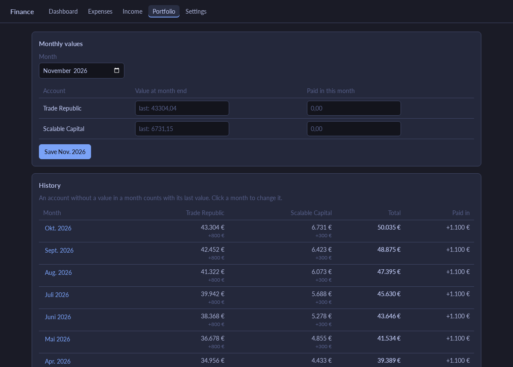

# Finance

A personal finance dashboard for [Omarchy](https://omarchy.org/): regular
expenses and income, broker accounts with monthly values and pay-ins, and the
numbers that matter on the way to financial independence (FI). No account and
no sync: everything stays in one file on this computer.

It runs as an Omarchy web app: a small local server and a "Finance" window
in the app launcher. Colors follow the current Omarchy theme.


## Install

Needs Omarchy (tested with 4.5.0), Python 3.11 or newer, and Chromium
(Omarchy's default browser).

```bash
git clone https://github.com/simonmcschubert/omarchy-finance.git ~/.local/share/omarchy-finance
~/.local/share/omarchy-finance/setup
```

`setup` adds a user service (`omarchy-finance.service`) that runs the server
at login on `http://127.0.0.1:47219/`, and a "Finance" entry in the app
launcher (`Super+Space`). The server reads the code from the cloned
directory, so keep it where it is.

## Update

```bash
git -C ~/.local/share/omarchy-finance pull && ~/.local/share/omarchy-finance/setup
```

`setup` restarts the server with the new code. Updates never touch the data.

## Remove

```bash
~/.local/share/omarchy-finance/setup --remove
rm -rf ~/.local/share/omarchy-finance
```

The data file stays.

## Use

- **Expenses** and **Income**: regular payments with a name, a category, an
  amount, and how often they are paid (monthly, every 2 months, quarterly,
  every 6 months, yearly). Enter income after tax. Only current amounts: when
  the rent goes up, edit it and the numbers change.
- **Portfolio**: broker accounts, and per month each account's value at month
  end and what was paid in that month (negative for withdrawals). An account
  without a value in a month counts with its last value.
- **Settings**: safe withdrawal rate (default 4 %) and a buffer on expenses
  for irregular costs (default 10 %).



### Dashboard numbers

| Number | How it is calculated |
| --- | --- |
| Monthly income | Sum of income, each divided by its months (a yearly bonus counts one twelfth) |
| Monthly expenses | Sum of expenses the same way, plus the buffer |
| Investment rate | Average monthly pay-in over the last 12 months ÷ monthly income |
| Portfolio | Sum of all accounts in the latest month |
| FI number | Monthly expenses × 12 ÷ withdrawal rate (× 25 at 4 %) |
| FI reached | Portfolio ÷ FI number |

With less than 12 months of history, the average uses the months there are.

The chart shows the portfolio value and the running total of pay-ins per
month. **Up to FI number** scales it to the FI number; **Fit to data** zooms in.

### Importing past months

Portfolio → **Import past months from CSV**: choose a file or paste rows
copied from a spreadsheet. One row per account and month:

```csv
month;account;value;pay_in
2025-01;Trade Republic;12.345,67;500
2025-01;ING;8.000;0
```

- Semicolons, commas or tabs between columns.
- Months as `2025-01`, `01/2025`, `01.2025` or a date such as `31.01.2025`.
- Amounts like `1.234,56` or `1,234.56`. A separator followed by exactly three
  digits is a thousands separator: `1.234` is 1234 €.
- `pay_in` is optional; empty means 0.
- New account names become new accounts. A row for a month and account that
  already exist replaces the old values.

Check shows what will happen. Nothing is imported while any line has a
problem.

## Data file

`~/.local/state/omarchy-finance/finance.json`, in a directory only the owner
can open. Copy it to back it up. Amounts are stored in cents.

If the file cannot be read, Finance shows an error and saves nothing until the
file is fixed or moved away. When two Finance windows are open, a save from a
window with old data is refused and that window reloads.

## Security

The server listens on `127.0.0.1` only. It answers only requests addressed to
`127.0.0.1:47219` or `localhost:47219` and refuses writes from other web
pages, so a website open in the browser cannot read or change the data. Other
programs running as the same user can, as with any file in the home
directory.

## Development

```text
server.py          # local server: page, /api/data (load/save), /theme.css
app/
├── index.html
├── app.mjs        # the views; saves every change
├── finance.mjs    # data format, parsing, metrics, CSV import (no DOM)
├── chart.mjs      # portfolio chart (SVG)
└── style.css
setup              # user service and launcher entry; --remove undoes
```

Run it without installing, with its own data file:

```bash
./server.py --port 8123 --data /tmp/finance-dev.json
```

Tests:

```bash
node --test                               # finance.mjs
python3 -m unittest discover -s test      # server.py
```
