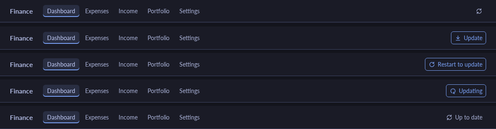
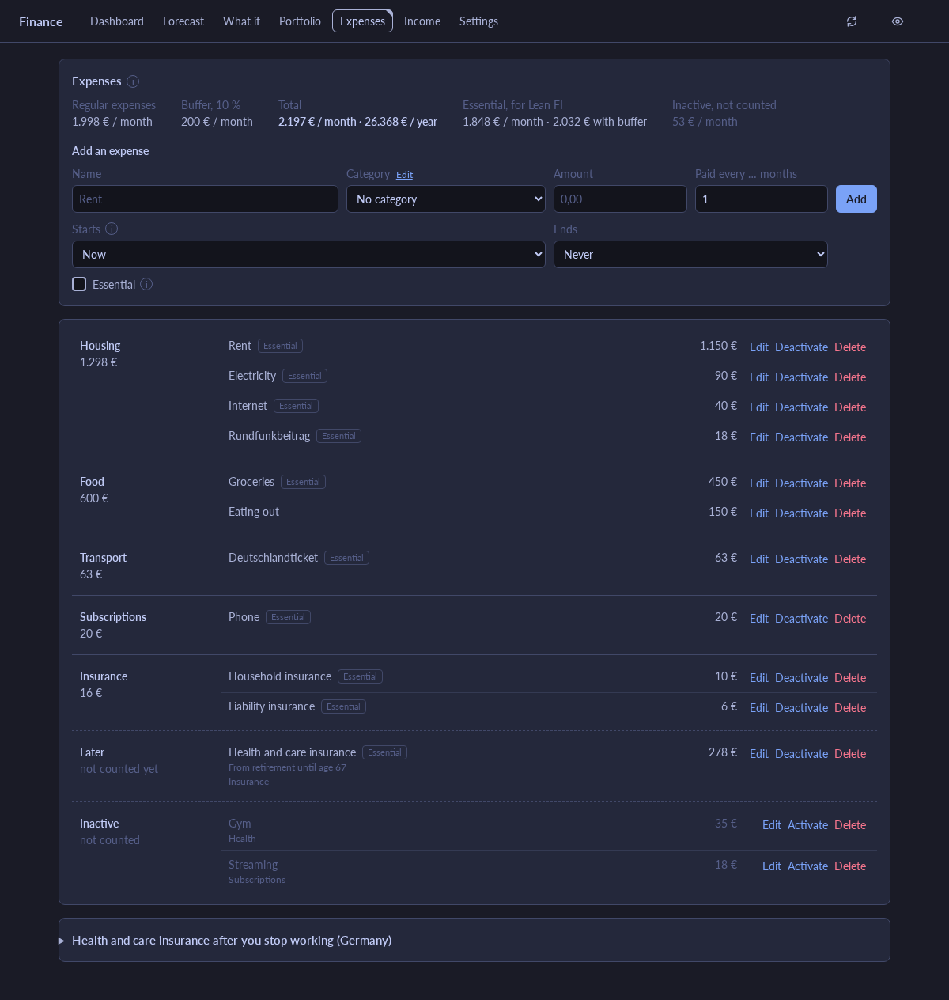
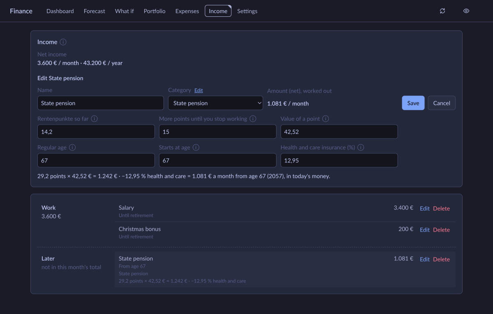
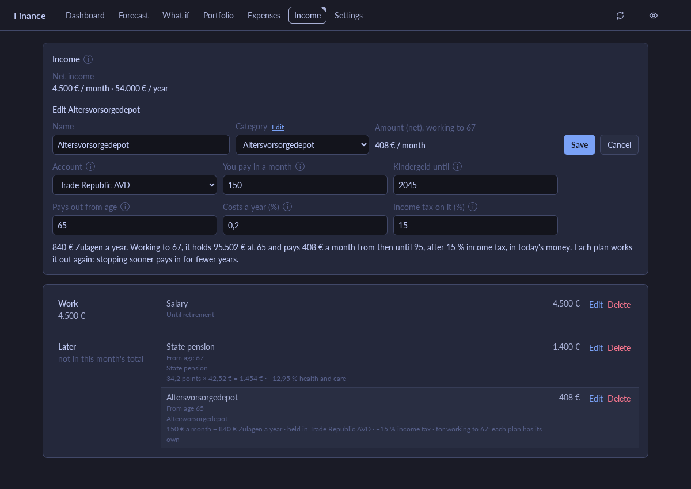
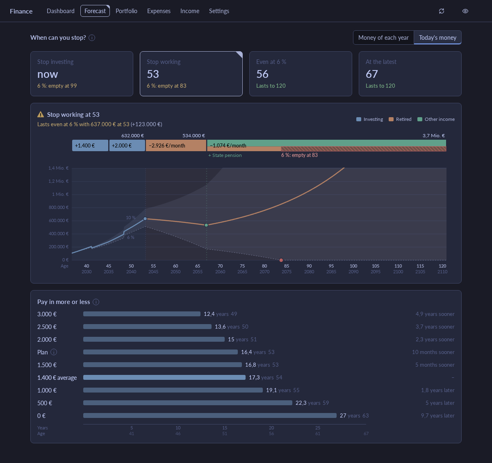
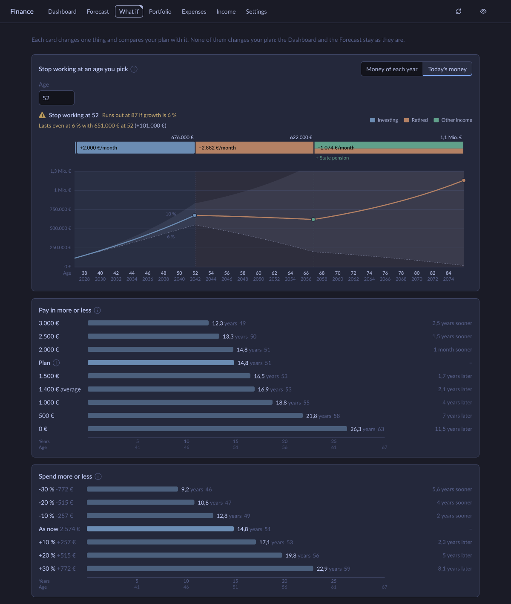
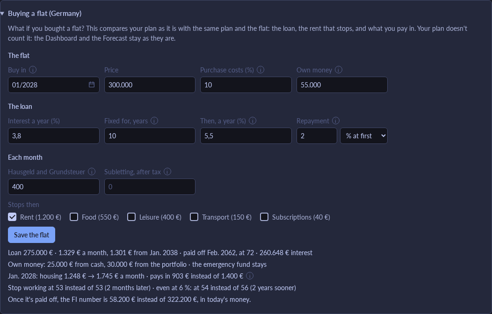

# Finance

A personal finance dashboard for [Omarchy](https://omarchy.org/): regular
expenses and income, the monthly values of your accounts, and the numbers
that matter on the way to financial independence (FI), with a forecast of
how your portfolio could grow and whether it lasts, a state pension
included. No account and no sync: everything stays in one file on this
computer.

It runs as an Omarchy web app: a small local server and a "Finance" window
in the app launcher. Colors follow the current Omarchy theme; the charts
keep colors of their own, so that their lines stay apart in every theme.


## Install

Needs Omarchy (tested with 4.5.0), Python 3.11 or newer, and Chromium
(Omarchy's default browser).

```bash
git clone https://github.com/simonmcschubert/omarchy-finance.git ~/.local/share/omarchy-finance
~/.local/share/omarchy-finance/setup
```

`setup` adds a user service (`omarchy-finance.service`) that runs the server
at login on `http://127.0.0.1:47219/`, and a "Finance" entry in the app
launcher (`Super+Space`). The server reads the code from the cloned
directory, so keep it where it is. It asks for `sudo` once, to install the
[lock](#lock)'s polkit action; without it, Finance runs unlocked.

## Update

Finance looks for a new release 15 seconds after its server starts and every
four hours. The update button, a circle of arrows at the right end of the top
bar, checks now when clicked; hover it to see the installed version. When
there is a release, the button turns into a down arrow with **Update**. One
click downloads and installs it: Finance restarts its server with the release
and reloads the window. A release downloaded otherwise (`update download` in
a terminal, or a window closed while it downloaded) shows **Restart to
update** instead, which installs it the same way. When the
new server does not answer, Finance goes back to the version it had. A
notification confirms the update or says why it failed. When it fails before
the restart (local changes in the checkout, for example), the button says
**Update failed** and why, when hovered. Like `git pull`, this does not show
the changes first; the release notes on GitHub list them. Updates never touch
the data.



Settings › General › Updates chooses which updates the button offers. **Stable**, the
default, offers releases. **Preview** offers every change on `main` as soon
as CI has passed for it, days or weeks before it is released: new features
first, and now and then a new bug. A preview is named by its commit, such as
`preview 1a2b3c4`, and the installed version then reads `0.2.0-3-g1a2b3c4`:
three commits past 0.2.0. Previews have no release notes; the commits on
GitHub list the changes. Back on Stable, Finance keeps the version it has
until a release is newer. It never goes back to an older version, which
could not read data saved by a newer one.


Looking for updates asks the repository Finance was cloned from (GitHub) for
its tags, and on Preview for its `preview` branch. Nothing about the data is
sent.

The same from a terminal:

```bash
~/.local/share/omarchy-finance/update check
~/.local/share/omarchy-finance/update install 0.2.0
~/.local/share/omarchy-finance/update channel preview   # or stable
```

`git -C ~/.local/share/omarchy-finance pull && ~/.local/share/omarchy-finance/setup`
works too, and is how a copy installed before the update button gets it. It
takes the newest commit on `main`, released or not. Run `setup` again after
an update when the release notes say so, for changes to the service or the
launcher entry.

## Remove

```bash
~/.local/share/omarchy-finance/setup --remove
rm -rf ~/.local/share/omarchy-finance
```

`setup --remove` also takes out the lock's polkit action (with `sudo`) and the
Finance window's browser profile. The data file stays.

## Use

- **Dashboard**: the numbers on the way to FI, the milestones (Coast FI,
  Lean FI and FI), the portfolio's path to FI and its history, the returns,
  the net worth with the emergency fund, and where the income goes. See
  [Dashboard numbers](#dashboard-numbers).
- **Forecast**: when you can stop investing and stop working, from the
  earliest age to the one that lasts even at low growth, each as a plan
  with its phases on an age line to 85 and its portfolio at 6, 8 and 10 %
  a year before inflation (by default). It only shows: what it goes on is
  set in Settings. See [Forecast](#forecast).
- **What if**: what one change would do to your plan, without changing it:
  stopping at an age you pick, paying in or spending more or less, a
  one-off you haven't planned, another return or inflation, and buying a
  flat. See [What if](#what-if).
- **Portfolio**: each account's value at the end of each month, and what
  was paid in, under a short summary, with the history. See
  [Portfolio, net worth and returns](#portfolio-net-worth-and-returns).
- **Expenses** and **Income**: regular payments, from now or a month to
  come, until they end, under a short summary of the totals. See
  [Expenses and income](#expenses-and-income). Portfolio, Expenses and
  Income are for entering; the Dashboard and the Forecast show what it
  comes to, and What if what a change would.
- **Settings**, in three tabs. **Data**, what the numbers go on:
  - Safe withdrawal rate (default 4 %) and a buffer on expenses for irregular
    costs (default 10 %).
  - Expected return (default 8 %): the portfolio's yearly return before
    inflation, for Time to FI, the Path to FI chart and the forecast.
  - Inflation (default 3 %): how much prices rise a year. Time to FI, the
    Path to FI chart and the forecast raise the expenses and the FI number
    by it, so their amounts are in the money of each year. Pay-ins stay as
    they are unless you choose otherwise (see Future pay-ins). Data files from before this setting get
    3 % inflation and 3 points more expected return, so 5 % after inflation
    becomes 8 % before it.
  - Life expectancy (default 100): the age your money should last to. The
    forecast ends with that year, and a plan lasts when money is left
    then; an Altersvorsorgedepot pays out until then too. Never below the
    retirement age. Data files from before this setting keep 120, the age
    the forecast used to go to.
  - Future pay-ins: what you pay in a month from now on, for the investment
    rate, the milestones, the Path to FI chart and the forecast. **Now** is
    the average pay-in of the last 12 months (default), which follows your
    pay-ins as you enter them, or an amount of your own. Add the **changes**
    you know are coming, each from a month or an age on, until the next
    one: a raise from April, nothing during a sabbatical and then the
    average again, 500 € from age 45. A change that has started is what you
    pay in now, until you delete it.
  - Rise with inflation (off by default): off, every pay-in stays the same
    amount of money for good. On, pay-ins are in today's money like your
    expenses, and the projections raise them by the inflation.
  - After Coast FI, per month (default 0): what the Forecast's Stop
    investing still pays in once Coast FI is reached. It stays the same amount of
    money, also with rising pay-ins.
  - Emergency fund (default 6): how many months of expenses to keep in
    emergency-fund accounts; 0 sets no target.
  - Planned one-offs; see [Forecast](#forecast).
  - Categories, one list for expenses and one for income. A new data file
    starts with a few common ones. Renaming a category renames it on every
    expense or income that has it; deleting one leaves them without a
    category. State pension, an income category, is built in: it can't be
    renamed or deleted (see [Expenses and income](#expenses-and-income)).
  - Accounts, each with what it holds; see
    [Portfolio, net worth and returns](#portfolio-net-worth-and-returns).
    Deleting one deletes its monthly values too.

  **General**, what seldom changes:
  - Currency (default euro). It only changes how amounts are shown; nothing
    is converted.
  - Number format for amounts and percentages: `1.000.000,00` (default),
    with the currency sign after the amount (`1.234,56 €`), or
    `1,000,000.00`, with it before (`€1,234.56`). Amounts can be typed
    either way. Dates follow the system language.
  - Year of birth and the retirement age (default 67): the age you stop
    working at the latest, for employees usually when the state pension
    starts without deductions. The forecast works out when you could stop
    sooner. The forecast needs the year of birth; it is
    empty until entered. Ages and retirement start in January of their year.
  - The [lock](#lock): on or off.
  - Where the data file and its daily backups are, and which updates to
    offer.

  **Export/Import**: import past months from CSV, and export all monthly
  values as CSV.

The pages keep their text short. An ⓘ next to a number, a column or a field
explains it: what it means, how it is worked out, and what is assumed. Click
it, or press Enter on it, to open it; Esc or a click elsewhere closes it.


`Ctrl+1` to `Ctrl+7` open Dashboard, Forecast, What if, Portfolio, Expenses,
Income and Settings. `Ctrl+Shift+H`, or the eye at the right end of the top bar, hides
every amount (as `••• €`, in charts and amount fields too) and keeps the
percentages, for sharing the screen; again shows them. The choice is kept in
this browser.

### Lock

With the lock on, Finance shows nothing until the system has confirmed it's
you, in Omarchy's own dialog: touch the fingerprint sensor, or type your
password; with the lid shut, it asks for the password. Opening Finance asks
straight away.
Finance locks again after 20 minutes without use (keys, clicks, scrolling),
when the computer sleeps, with `Ctrl+L` or the padlock at the right end of the
top bar, and when its server restarts, after an update for example. While it
is locked, the page forgets the data, and the server gives it to no one: not
to the page, and not to other programs on the computer. To unlock it, press
`Ctrl+L` again, or **Unlock**.

The lock is on once `setup` has installed its polkit action. Until then, its
box in Settings › General › Lock is greyed out and names the command. The fingerprint
needs Omarchy's fingerprint setup (Omarchy menu › Setup › Security ›
Fingerprint); without it, the dialog asks for the password. Settings ›
General › Lock turns the lock off, after the same dialog, and on again. If the dialog never
appears, `sudo rm /usr/share/polkit-1/actions/io.github.simonmcschubert.omarchy-finance.policy`
turns the lock off until `setup` runs again.

### Expenses and income

Each expense and income has a name, a category, an amount, and how often it
is paid, in months (1 monthly, 3 quarterly, 12 yearly, 24 every two years,
or any other number up to 120). Enter income after tax. Only current
amounts: when the rent goes up, edit it and the numbers change.

- **Starts** now, at retirement, at an age or in a month, and **ends**
  never, at retirement, at an age or after a month: childcare from August
  2027 until July 2031, health insurance from retirement until 67, a state
  pension from 67, a salary until retirement. It counts only in its
  months: what does not count this month is listed under Later or Ended,
  and is left out of the totals. In the forecast, retirement is each plan's
  own (for Retire at FI, the month after FI). New income ends at
  retirement; new expenses never end. Income from before starts and ends
  ends at retirement, as it was never counted after it; change that for
  income that goes on, such as rent from a flat.
- **Essential** marks an expense you would pay even on the leanest budget
  (rent, food, insurance): those count for Lean FI as well. New expenses
  are not essential.
- **Deactivate** sets an expense inactive: it stays in the list, under
  Inactive, but counts nowhere (not in the totals, the FI number or the
  charts) until **Activate** counts it again.

Three things, for Germany, add what changes when you stop working:

- **State pension**, an income category of its own: picked in the Income
  form, its fields take the place of the amount, how often, and when it
  starts and ends. Your Rentenpunkte so far, from the Renteninformation,
  plus those of the years you still plan to work, times the value of a
  point (42,52 € from July 2026), 0,3 % less a month before the regular
  age (67 for everyone born in 1964 or later, a field of its own; at most
  4 years) or 0,5 % more a month after it, less what pensioners pay for
  health and care insurance (12,95 % by default). The amount is worked out
  as you type, and paid every month from the age it starts, for good. The
  inputs are kept: its row in the list says how the amount comes about,
  and Edit opens the same fields, filled in. The category is built in,
  and there is one state pension. The Renteninformation's own pension at
  67 assumes you pay in until then; early retirees get less. A state
  pension added before kept only its amount: it moves into the category,
  and Edit asks for its Rentenpunkte once.
- **Altersvorsorgedepot**, the pension depot the state subsidises from
  2027 (Altersvorsorgereformgesetz of 26 May 2026), another income
  category of its own: picked in the Income form, its fields take the
  place of the amount, how often, and when it starts and ends. The pension
  account its value is entered in (or none yet: it starts from 0), what
  you pay in a month (at most 150 €, 1.800 € a year: what gets a Zulage),
  the last year of Kindergeld for each child, the age it pays out from (65
  to 70), its costs a year (0,2 % by default) and the income tax on what
  it pays out (15 % by default: it is taxed in full as income). The state
  adds Zulagen once you pay in 120 € a year: 50 % of the first 360 €, 25 %
  up to 1.800 € (540 € at most), and 100 % up to 300 € per child, each
  year's in the January after. Its amount is never fixed: every plan works
  it out for when it stops working, as you pay in and get Zulagen only
  while you work. From the account's latest value it grows by the expected
  return less the costs (by the low and high growth in their runs), then
  pays out the same amount in today's money every month until your life
  expectancy (85 at the least, as the law has it), less the tax. Stopping
  at 50 instead of 67 leaves it much less. Its row says what it comes from
  and its amount for working to the retirement age. The category is built
  in, and there is one depot; its account stays pension assets while it
  holds it, and a flat can't end it. Left out: the 30 % lump sum, payouts
  that change every few years, a second contract, contributions above
  150 € a month, and the tax refund a high income brings on top of the
  Zulage, which goes to you rather than into the depot.
- **Health and care insurance after you stop working**, at the bottom of
  Expenses: as a voluntary member of a statutory insurer, at least the
  minimum base (1.318,33 € a month in 2026) × 14 % + the Zusatzbeitrag
  (2,9 % on average) + care insurance (4,2 % without children, 3,6 % with):
  about 280 € a month. Added as the essential expense "Health and care
  insurance" from retirement until the age the pension starts.

All the numbers can be changed. Income tax is left out but for the
Altersvorsorgedepot's.







### Portfolio, net worth and returns

Each account holds something: **invested** (brokers, ETF savings plans:
the portfolio), **cash** (money you may spend, such as savings for a
flat), **emergency fund** (Tagesgeld you keep for emergencies),
**property**, **pension assets** (Riester, Rürup, an Altersvorsorgedepot, a
company pension: locked until retirement) or **debt** (what is still owed, such as a mortgage). Only
invested accounts are the portfolio that the FI number, Time to FI and the
forecast count; all of them, debts taken off, are the net worth. Accounts
are set up in Settings; those from before kinds, and new ones from a CSV
import without a kind, are invested. Cash accounts from before the
emergency fund had a kind of its own became emergency-fund accounts: set
those you may spend to cash.

Per month, enter each account's value at month end. For invested accounts
also what was paid in that month (negative for withdrawals), and a
**one-off**: a lump sum in or out, such as an inheritance or a house
deposit. A one-off counts as paid in (so it is no gain), but not for the
average pay-in that the investment rate, Time to FI and the forecast go on
with, unless Settings plans your own future pay-ins. An account without a value in a month counts with its last value.
The history lists every month with each account, the portfolio, what was
paid in and, with other kinds of accounts, the net worth. The summary at
the top has the portfolio in its latest month, that month's change and
pay-in, the average pay-in of the last 12 months and, with other kinds of
accounts, the net worth.


**Returns**, on the dashboard under the Portfolio history chart, for the
portfolio and each invested account:

- Time-weighted this year, over the last 1, 3 and 5 years (3 and 5 a year)
  and since the start: each month's return (the change in value less what
  went in, ÷ the value at the start plus half of what went in) chained.
  It says what the investments did, whenever money went in or out, and
  compares with an index or a fund.
- Money-weighted since the start (the internal rate of return): what your
  money earned, with when it went in; paying in before a rise makes it
  higher, before a fall lower.

Since the start, both are a year from 12 months of history on, and over the
whole time before. Pay-ins, one-offs and an account's first value count
from the middle of their month. A month that ends with less than half of
what went in has no time-weighted return (it would be a loss of more than
everything), and neither has a time-weighted period with it: it shows “–”.
A column no row has a number for, such as 5 years with a shorter history,
is left out.

**Emergency fund**, at the foot of Net worth on the dashboard: the latest
values of the emergency-fund accounts ÷ this month's expenses with buffer,
how much of the months set in Settings that is, and how much is missing.
It shows once there is an emergency-fund account and an expense that
counts this month.

### Dashboard numbers

| Number | How it is calculated |
| --- | --- |
| Monthly income | Sum of the income that counts this month, each divided by its months (a yearly bonus counts one twelfth) |
| Monthly expenses | Sum of the active expenses that count this month the same way, plus the buffer |
| Investment rate | What you pay in now ÷ monthly income: the average monthly pay-in over the last 12 months (one-offs left out), your own amount from Settings, or a planned change that has started |
| Portfolio | Sum of the invested accounts in the latest month, and its change since the month before |
| Gains, last 12 months | Change in portfolio value over the last 12 months minus what went in, and how much that was: the pay-ins and one-offs, and what an account held in its first month. The returns are in their own card |
| Expenses covered | Portfolio ÷ monthly expenses: how long it would pay for them |

With less than 12 months of history, the average uses the months there
are, and so do the gains, from the first month on.

When last month has no values yet, the Portfolio tile says so ("Okt. 2026
not entered yet", or how many months are missing) and links to the first
month without values.

**Milestones** lists the milestones on the way to FI, in the order the
portfolio reaches them. Each says what the portfolio needs (and how much
is still to go), how much of it the portfolio has, and when it gets there:
how long from this month (which can be after the latest month with
values), and the month with your age then.

| Milestone | Needs |
| --- | --- |
| FI | The FI number: what the portfolio would need when retiring now. What it pays a month: the expenses that count then, plus the buffer, less the income that does. Once nothing starts or ends any more, that amount × 12 ÷ withdrawal rate (× 25 at 4 %); until then, what it pays on top of that, month by month, such as bridging the years until a pension starts. Never more than the highest monthly amount × 12 ÷ withdrawal rate. Without starts and ends: monthly expenses × 12 ÷ withdrawal rate |
| Lean FI | The same for the essential expenses only, with the buffer: the FI number for a lean budget. Shown once an active expense is essential |
| Coast FI | What the portfolio needs now to grow to the FI number by the retirement age without another pay-in, at the expected return, plus what planned one-offs take out before then: as Stop investing on the Forecast page counts it. Planned pay-ins and one-offs that pay in don't lower it; they only make the portfolio get there sooner. Shown with a year of birth, until retirement |

How much it has is the portfolio ÷ what it needs. When, for FI and Lean
FI, is Time to FI, counted as the Forecast page's Stop working counts it.
From the latest month the portfolio grows by the expected return
(compounded monthly) and gets the future pay-ins each month (the average
monthly pay-in of the last 12 months, 0 when that is a withdrawal, or your
own amount from Settings, then the planned changes; raised by the
inflation if you chose so), with the planned one-offs, while the FI number
rises by the inflation. FI is the end of the first month in which the
portfolio reaches the FI number of retiring the month after. It counts only
before retirement ("Not before 67"); without a year of birth, up to 100
years. Years from two years on. For Coast FI, it is the first month
from which the portfolio, with the same pay-ins until then and none after,
grows to the FI number by the retirement age: the age the Forecast page's
Stop investing names, for the future pay-ins and nothing after Coast FI.

Under the milestones come two charts, one under the other:

- **Path to FI** (needs active expenses): from the latest month, the value
  goes on growing the way Time to FI counts, with planned one-offs, as a
  dashed line until it reaches the FI number, with a band from 2 points
  below to 2 points above the expected return (6 % to 10 % at 8 %), also up
  to the FI number, and never past retirement. From the latest month on, the
  FI number is what FI needs at each month's end, that of retiring the month
  after, risen by the inflation. The line under the chart
  says when each reaches the FI number, at the expected return also how
  long that is from this month; its ⓘ, what the FI number is by then.
  Its switch shows the projection in today's money (the default) or in the
  money of each year, as on the Forecast page.
- **Portfolio history**: the portfolio value and what was paid in, per
  month. Paid in starts with what each account held in its first month,
  then adds its pay-ins, so the space between the lines is the gain (green)
  or loss (red) since then. Hovering a month shows the gain in money and
  percent, and how much of that month's change was paid in and how much
  came from the market. The FI number shows once the data reaches it.


**Returns** sits under the history; see
[Portfolio, net worth and returns](#portfolio-net-worth-and-returns).

**Net worth**, once there is an account that is not invested, adds up the
latest value of every account, debts taken off, with each kind on a bar,
and its change since the month before (left out in a month an account is
entered for the first time). The emergency fund is at its foot.

**Where the income goes** splits the monthly income into expenses (with
the buffer), what you pay in now (the 12-month average or your own amount),
and what is left over, or says how much more than the income those two take.
**Expenses by category** shows the expenses without the buffer.

### Forecast



**When can you stop?** Four answers, a card each, and each answer is a
plan:

| Card | Plan |
| --- | --- |
| Stop investing · now (or the age of Coast FI) | investing until Coast FI, then coasting: working, and paying in only the amount set for after Coast FI in Settings (default 0), then retired from the retirement age |
| Stop working · 53 (the age FI is reached) | investing until FI, then retired from the month after |
| Even at 6 % · 56 | investing until January of the first age from which the money lasts to the life expectancy even at the low growth, then retired. Only when stopping at FI runs out at the low growth; “–” when no age before the retirement age lasts |
| At the latest · 67 (the retirement age) | investing until retirement, then retired |

Under the age, each card says whether that plan's money lasts to the life
expectancy from Settings: “Lasts to 100” even at the low growth (6 % by
default), “6 %: empty at 83” when it
runs out at the low growth only, “Empty at 90” when it runs out at the
expected return. A plan that doesn't happen before retirement says “Not
before 67”. Once retired, one card says so.

Click a card, or move with the arrow keys, to see its plan in the card
below (the picked card has a bright border and corner): its name, with a
check, warning or cross for whether the money lasts, its bar on an age line
from now to 85 (or to the life expectancy, when that is sooner), and its
chart. Whether the money lasts is still worked out to the life
expectancy: a plan that runs out at 90 says so on its card, with no mark
on the bar or the chart. Once you are 85, they go to the life expectancy.
The plan picked stays picked in this browser.

Each phase is a stretch of the bar: **Investing** (blue) with what is paid
in a month as planned in Settings, a part for each amount (`+1.400 €`, then
`+2.000 €/month` from a planned change), **Coasting** (hatched) and
**Retired** (orange) with what the portfolio pays a month: the expenses
with buffer, less the income that counts then, in today's money. Hovering a
part shows its amount and ages, also where the bar is too narrow for them.
Above the bar, what the portfolio has when a phase or step ends. A plan
that doesn't happen before retirement says “Not before 67”.

While retired, a step splits the bar wherever that amount changes, with its
cause under it: an income that starts (“+ State pension”,
“+ Altersvorsorgedepot”, a private pension, rent) or an expense that ends. A cause that would run into the one
before goes a line lower. The bar's height splits into what the portfolio
pays (orange) and what other income pays (aqua), so a large pension shows
as mostly aqua, a small one as a thin line, and none as orange to the end.
Nothing in the forecast needs a pension.

Where the money runs out, the portfolio's part of the bar turns red
(“6 %: empty at 83”); other income goes on.

When the picked plan runs out, a line under its name says what would make
it last anyway: “Lasts even at 6 % with 781.000 € at 53 (+242.000 €)”.
That is the portfolio it would need when it stops investing or working
(now, for a plan that stops now) for the money to last to the life
expectancy with only
the low growth from then on, up to whole thousands; in brackets, how much
more that is than it would have then at the low growth.

The chart under the bar is on the same age line: the portfolio at the
expected return, colored by phase, with a band from 2 points less to 2
points more growth. The band and the low and high results keep the plan's
dates from the expected return (stopping at 53 stays stopping at 53), so
they show what happens to the same plan when markets do worse or better. A
red dot marks where the money runs out. Hovering a year, or the arrow keys
on the chart, shows the three values.

The switch at the top of the page shows the portfolio in today's money
(the default: what it would buy now, with the inflation since the latest
month taken out) or in the money of each year. The Path to FI chart on the
dashboard has the same switch; the choice is remembered in this browser,
not in the data file.

- It starts from the portfolio in the latest month, and grows it by the
  growth rate every month (8 % a year is about 0.64 % a month), as Time to
  FI on the dashboard does. Stop working retires when that counts FI.
- Retirement starts in January of the year you reach the retirement age.
  Expenses and income that start or end at retirement follow each plan's
  retirement; for Retire at FI that is the month after FI.
- Growth is before inflation, and the expenses rise by the inflation from
  Settings (3 % a year by default). Pay-ins stay the same unless they rise.
- The growth is the same every year. Real markets are not, and bad years
  right after you start living off the portfolio hurt most. Taxes are left
  out, but for the income tax set on an Altersvorsorgedepot.

**Planned one-offs**, in Settings › Data, are money that comes in
or goes out once in a month to come: an inheritance, a house deposit, a
car, a sabbatical (what you live on then, and the pay-ins you skip). Every
plan gets them in their month, as do Time to FI and the Path to FI chart.
Coast FI sets aside those that take money out before retirement, but never
counts on one that pays in before it comes. Amounts are in
today's money and rise with inflation, like expenses. They are saved; a
one-off that has happened goes under Portfolio.

The page has nothing to fill in: the amount after Coast FI, the planned
one-offs, the year of birth and the retirement age are in Settings. What
other choices would do is on What if.

### What if



Each card changes one thing and compares your plan with it. None of them
changes your plan: the Dashboard and the Forecast stay as they are. Like
the Forecast, the cards need your year of birth and your expenses; Buying
a flat works without them, but compares no ages then. Each counts when
you could stop working as the Forecast's Stop working does, at the
expected return, and with your planned one-offs.

**Stop working at an age you pick**: type an age, from this year's (now)
to the retirement age, and see the plan that stops working in January of
the year you turn it, whatever the portfolio has then, and lives off it
from then on; never before this month, as the months until now are worked
already. Until then you pay in as planned in Settings. It is drawn as
the Forecast draws its plans: the name with a check, warning or cross and
whether the money lasts, the bar of the phases on the age line, and the
chart with the band from 2 points less to 2 points more growth. The bar
and the chart end at 85, while whether the money lasts is still worked out
to the life expectancy, as on the Forecast: a plan that runs out at 90
says so by its name. When
the money runs out, the line under the name says what the portfolio would
need when you stop to last even at the low growth, as on the Forecast. It
starts at the first age whose January is no sooner than Stop working stops
(the retirement age when that is none), and keeps the age you pick until
the window closes. The switch at
its top shows today's money or the money of each year, as on the Forecast.

**Pay in more or less** shows what paying in more or less does: a bar for
each amount a month, from now to when you could stop working (as Stop
working counts it, at the expected return), with how long that is from
this month and your age then after it ("12,4 years 49"), and how much
sooner or later that is than with your plan (bold). Both are in months
under a year, else in years to a tenth; sooner
or later is the difference of the tenths shown, so the rows add up. The
line under the bars counts years from now, with your age then under it,
and ends at the retirement age; hovering a bar shows its month and your
age. The amounts are 0 to 3.000 in steps of 500, and the average pay-in
of the last 12 months among them (it takes the place of the one it
equals), each paid in every month from now on (rising with inflation when
pay-ins do). **Plan** is what you pay in as set in Settings, with its
changes (its ⓘ lists them), and stops when the Stop working card does.
When it pays in the same every month, the average or an amount of your
own, it is the row of that amount ("Plan 1.400 average"); when it
changes, a row of its own. A hatched bar doesn't reach FI before the
retirement age. The card isn't there once FI is reached, or once retired.

**Spend more or less** is the same for spending: every expense, and the
buffer with it, 30 % less to 30 % more in steps of 10, from now on and for
good. Your income stays the same, so what you spend less you pay in while
you work, on top of what you pay in as planned; what you spend more comes
out of it, never below 0. That rises with inflation, like the expenses.
Spending less counts twice: you pay in more, and the FI number falls with
your expenses. Next to each share, what it changes a month now (with the
buffer); **As now** (bold) is your plan as it is, with your expenses this
month. The card isn't there once retired.

**A one-off you haven't planned**: a month (this month or later, after the
latest month with values) and an amount, negative for money taken out,
such as an inheritance, a bonus or a car. As you type, it says when you
could stop working with it instead of without, and from when the money
lasts even at the low growth, and how much sooner or later each is: “Stop
working at 49 instead of 52 (2,4 years sooner) · even at 6 %: at 52
instead of 55 (3 years sooner)”. The amount is in today's money and rises
with inflation until its month, like a planned one-off. Nothing is saved:
to count it, add it to the planned one-offs in Settings › Data.

**Growth and inflation**: a table of the age you could stop working at,
with the expected return from 2 points less to 2 points more (a row each)
and inflation from 1 point less to 1 point more, never below 0 (a column
each). Yours from Settings is framed. Under an age, where the money runs
out at that return after stopping then; nothing when it lasts to the life
expectancy, and
“–” when you can't stop before the retirement age. Hovering a cell shows
the month. Higher inflation raises the expenses, the FI number and the
planned one-offs; pay-ins rise with it only when they are set to. Unlike
the Forecast's band, which keeps the dates of the expected return, each
return here has its own: when you could stop at it.

#### Buying a flat

**Buying a flat (Germany)** compares your plan as it is (renting) with
the same plan and a flat. **Save** keeps its fields in the data file for
next time; **Delete** clears them.

- **The flat**: the month you buy it (and move in), the price, the
  purchase costs (default 10 %: Grunderwerbsteuer 3,5 to 6,5 % by state,
  notary and land registry about 2 %, an agent up to 3,57 %), and your own
  money, costs included. The own money comes from the latest values of
  your cash accounts first, then out of the portfolio as a one-off in that
  month; never from the emergency fund. The loan is the price and the
  costs, less the own money.
- **The loan**: the interest a year, fixed for a number of years (the
  Zinsbindung), then the interest after that (empty: the same). The
  repayment is either **% at first** (a year, the anfängliche Tilgung: the
  payment is the loan × (interest + repayment) ÷ 12, worked out again for
  what is left when the fixed years end), or an **amount a month**, the
  whole payment, the same until the loan is paid off. Either way the
  payment never rises with inflation; in today's money it gets smaller
  every year.
- **Each month**: Hausgeld and Grundsteuer, and subletting (rent you take
  in, after tax; optional). Both are in today's money and rise with
  inflation; subletting counts for good, also once you've stopped working.
- **Expenses that stop when you move in**, such as the rent: from that
  month on, within their own months (a rent that ends before saves
  nothing). Those that start at retirement aren't offered.
- **Income that stops when you move in**, such as the rent a flatshare's
  room brings in: the same, from that month on, while renting keeps it.

What you pay in changes each month by what housing costs more than
renting, in the money of that month: the payment, plus Hausgeld, less
subletting and the expenses that stop, plus the income that stops; all but
the payment rise with inflation. Once the loan is paid off, the payment drops out of it:
you usually pay in more then. A pay-in never goes below 0, and planned
pay-in changes after the purchase change by the same.

As you type, under a field it says what that works out to: how long
until you buy, the purchase costs, the loan, when the fixed years end, and
the first payment (or, for an amount a month, the repayment at first it
makes). Beside the fields (above them in a narrow window), a panel says
what the flat changes:

- when you could stop working with the flat (as Stop working on the
  Forecast counts it) and how much sooner or later that is than renting,
  and the same for from when the money lasts even at the low growth;
- a table of renting and buying side by side: those ages with their
  months, and the FI number once the loan is paid off. In a narrow panel
  the column of how much sooner or later is left out, as the lines above
  say it;
- in the month you buy, a bar for renting and one for buying: what
  housing costs that month, then what you pay in, on one scale, so the
  part that goes from paying in to housing shows;
- the loan: what it pays a month and from when, when it is paid off and
  the interest in all; and where the own money comes from.

A payment that doesn't cover the interest after the fixed years never pays
the loan off: the panel says so and compares nothing.



### Importing past months

Settings › Export/Import → **Import past months from CSV**: choose a file or paste rows
copied from a spreadsheet. One row per account and month:

```csv
date;account;value;pay_in;one_off;kind
31.01.2025;Trade Republic;12.345,67;500;0;invested
31.01.2025;ING;58.000;0;50.000;invested
31.01.2025;Tagesgeld;10.000;;;emergency
```

- Semicolons, commas or tabs between columns.
- Dates as `2025-01-31`, `2025.01.31` or `31.01.2025`. A row counts for the
  month of its date, so an account can have only one row per month.
- Amounts like `1.234,56` or `1,234.56`. A separator followed by exactly three
  digits is a thousands separator: `1.234` is 1234.
- `pay_in` and `one_off` are optional; empty means 0.
- `kind` is optional: what a new account holds (`invested`, `cash`,
  `emergency`, `property`, `pension` or `debt`; empty means invested). Accounts that
  exist keep their own.
- New account names become new accounts. A row for a month and account that
  already exist replaces the old values.

Check shows what will happen. Nothing is imported while any line has a
problem.

### Exporting

Settings › Export/Import → **Export CSV** saves every monthly value to
`finance-portfolio-<date>.csv` in the same columns, so the import reads it
back. Each row's date is the last day of its month. Amounts have two
decimals. Where the system language writes a decimal comma (German, for
example) the file uses decimal commas and semicolons between columns, as
spreadsheets there expect; otherwise decimal points and commas. The number
format in Settings does not change this.

## Data file

`~/.local/state/omarchy-finance/finance.json`, in a directory only the owner
can open. Copy it to back it up. Amounts are stored in cents (hundredths of
the currency). Files from older versions of Finance are upgraded on the
first change; those versions cannot read them after that.

Before the first change of each day, Finance keeps a copy of the file as it
was, as `backups/finance-<date>.json` next to it (for example
`finance-2026-11-16.json`), and keeps the copies of the last 30 days with
changes. A bad import or a slip can be undone by copying that day's file
over `finance.json`; open windows show it once they get focus. Settings ›
General › Data file shows where the copies are. A copy that cannot be written is
logged, and the change is still saved.

If the file cannot be read, Finance shows an error and saves nothing until the
file is fixed or moved away. When two Finance windows are open, a save from a
window with old data is refused and that window reloads.

## Security

The server listens on `127.0.0.1` only. It answers only requests addressed to
`127.0.0.1:47219` or `localhost:47219` and refuses writes from other web
pages, so a website open in the browser cannot read or change the data.

With the [lock](#lock) on, the data goes only to a window that was unlocked:
its session is an `HttpOnly` cookie that the page's scripts never see and the
server forgets when it locks. Other programs on the computer, other users
included, get nothing from the server without your fingerprint or password.
They can still read the data file itself if they run as you, as with any file
in the home directory; Omarchy's disk encryption protects it while the
computer is off.

The Finance window has a browser profile of its own
(`~/.local/state/omarchy-finance/browser`), so browser extensions and
everyday browsing don't share it. Copies installed before get it, and the
lock, when `setup` runs again.

## Development

```text
server.py          # local server: page, /api/data (load/save, daily backups), /api/lock, /api/update, /theme.css
app/
├── index.html
├── app.mjs        # the views; saves every change
├── finance.mjs    # data format, parsing, metrics, returns, forecast, German helpers, CSV (no DOM)
├── chart.mjs      # portfolio and forecast charts (SVG)
├── update.mjs     # the update button, and the channel in Settings
└── style.css
polkit/            # the lock's polkit action, which setup installs
setup              # user service, launcher entry and the lock's action; --remove undoes
update             # finds, downloads and installs releases or previews
```

Run it without installing, with its own data file:

```bash
./server.py --port 8123 --data /tmp/finance-dev.json
```

Tests:

```bash
node --test                               # finance.mjs, update.mjs, update
python3 -m unittest discover -s test      # server.py
```

The tests of `update` run it against real git repositories, with stand-ins
for `systemctl` and `curl`. A server started this way offers updates too,
but `update install` refuses a checkout that `omarchy-finance.service` does
not run, so installing one fails there.

## Releases

Actions › Release › Run workflow, with patch, minor, or major; the first
release starts from 0.0.0, so minor gives 0.1.0. The workflow tags the `main`
commit that passed CI as `vX.Y.Z` and creates the GitHub Release with notes
from the merged pull requests. The tags hold the version (`update version`).
Installed copies offer the release within four hours. "Release candidate"
publishes `vX.Y.Z-rc.N`, which they do not offer, and "Dry run" shows the
version and notes without publishing.

Previews need no step: once CI passes for a commit pushed to `main`, the
Preview workflow fast-forwards the `preview` branch to it, and copies on
Preview offer it within four hours.
