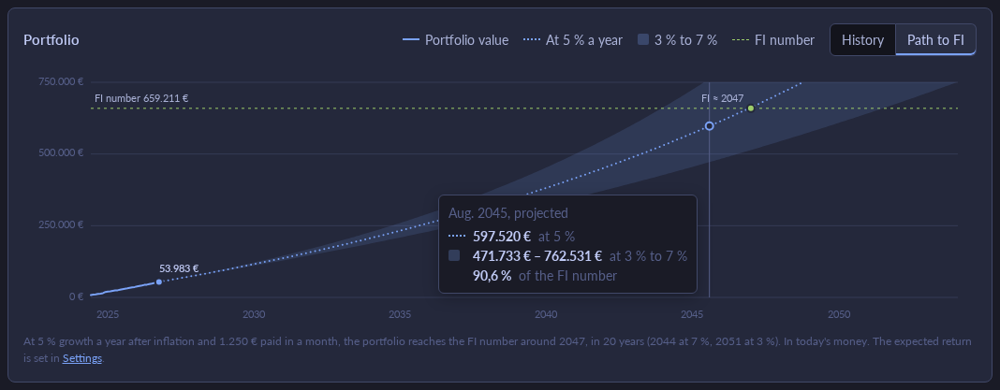

# Finance

A personal finance dashboard for [Omarchy](https://omarchy.org/): regular
expenses and income, broker accounts with monthly values and pay-ins, and the
numbers that matter on the way to financial independence (FI). No account and
no sync: everything stays in one file on this computer.

It runs as an Omarchy web app: a small local server and a "Finance" window
in the app launcher. Colors follow the current Omarchy theme.


## Install

Needs Omarchy (tested with 4.5.0), Python 3.11 or newer, and Chromium
(Omarchy's default browser).

```bash
git clone https://github.com/simonmcschubert/omarchy-finance.git ~/.local/share/omarchy-finance
~/.local/share/omarchy-finance/setup
```

`setup` adds a user service (`omarchy-finance.service`) that runs the server
at login on `http://127.0.0.1:47219/`, and a "Finance" entry in the app
launcher (`Super+Space`). The server reads the code from the cloned
directory, so keep it where it is.

## Update

Finance looks for a new release 15 seconds after its server starts and every
four hours. The update button, a circle of arrows at the right end of the top
bar, checks now when clicked; hover it to see the installed version. When
there is a release, the button turns into a down arrow with **Update**. Click
it to download the release, then click **Restart to update** to install it:
Finance restarts its server with the release and reloads the window. When the
new server does not answer, Finance goes back to the version it had. A
notification confirms the update or says why it failed. When it fails before
the restart (local changes in the checkout, for example), the button says
**Update failed** and why, when hovered. Like `git pull`, this does not show
the changes first; the release notes on GitHub list them. Updates never touch
the data.


Looking for releases asks the repository Finance was cloned from (GitHub) for
its tags. Nothing about the data is sent.

The same from a terminal:

```bash
~/.local/share/omarchy-finance/update check
~/.local/share/omarchy-finance/update install 0.2.0
```

`git -C ~/.local/share/omarchy-finance pull && ~/.local/share/omarchy-finance/setup`
works too, and is how a copy installed before the update button gets it. It
takes the newest commit on `main`, released or not. Run `setup` again after
an update when the release notes say so, for changes to the service or the
launcher entry.

## Remove

```bash
~/.local/share/omarchy-finance/setup --remove
rm -rf ~/.local/share/omarchy-finance
```

The data file stays.

## Use

- **Expenses** and **Income**: regular payments with a name, a category, an
  amount, and how often they are paid, in months (1 monthly, 3 quarterly,
  12 yearly, 24 every two years, or any other number up to 120). Enter income
  after tax. Only current amounts: when the rent goes up, edit it and the
  numbers change. **Deactivate** sets an expense inactive: it stays in the
  list, under Inactive, but counts nowhere (not in the totals, the FI number
  or the charts) until **Activate** counts it again. New expenses are active.
- **Portfolio**: per month, each broker account's value at month end and what
  was paid in that month (negative for withdrawals). An account without a
  value in a month counts with its last value.
- **Settings**:
  - Currency (default euro). It only changes how amounts are shown; nothing
    is converted.
  - Number format for amounts and percentages: `1.000.000,00` (default),
    with the currency sign after the amount (`1.234,56 €`), or
    `1,000,000.00`, with it before (`€1,234.56`). Amounts can be typed
    either way. Dates follow the system language.
  - Safe withdrawal rate (default 4 %) and a buffer on expenses for irregular
    costs (default 10 %).
  - Expected return (default 5 %): the portfolio's yearly return after
    inflation, for Time to FI and the Path to FI chart. After inflation,
    because the FI number is in today's money.
  - Categories, one list for expenses and one for income. A new data file
    starts with a few common ones. Renaming a category renames it on every
    expense or income that has it; deleting one leaves them without a
    category.
  - Broker accounts. Deleting one deletes its monthly values too.
  - Import past months from CSV, and export all monthly values as CSV.

`Ctrl+1` to `Ctrl+5` open Dashboard, Expenses, Income, Portfolio and Settings.


### Dashboard numbers

| Number | How it is calculated |
| --- | --- |
| Monthly income | Sum of income, each divided by its months (a yearly bonus counts one twelfth) |
| Monthly expenses | Sum of active expenses the same way, plus the buffer |
| Investment rate | Average monthly pay-in over the last 12 months ÷ monthly income |
| Portfolio | Sum of all accounts in the latest month, and its change since the month before |
| Gains, last 12 months | Change in portfolio value over the last 12 months minus the pay-ins. The return is that gain ÷ (the value 12 months ago + each pay-in for the part of the 12 months it was invested, from the middle of its month) |
| Expenses covered | Portfolio ÷ monthly expenses: how long it would pay for them |
| FI number | Monthly expenses × 12 ÷ withdrawal rate (× 25 at 4 %) |
| FI reached | Portfolio ÷ FI number |
| Time to FI | Months until the portfolio reaches the FI number: from the latest month it grows by the expected return (compounded monthly) and gets the average monthly pay-in each month. Years from two years on; nothing beyond 100 years |

With less than 12 months of history, the average uses the months there
are, and so do the gains, from the first month on.

When last month has no values yet, the Portfolio tile says so ("Okt. 2026
not entered yet", or how many months are missing) and links to the first
month without values.

The **Portfolio** chart has two views; the one picked last stays picked.

- **History**: the portfolio value and what was paid in, per month. Paid in
  starts with what each account held in its first month, then adds its
  pay-ins, so the space between the lines is the gain (green) or loss (red)
  since then. Hovering a month shows the gain in money and percent, and how
  much of that month's change was paid in and how much came from the market.
  The FI number shows once the data reaches it.
- **Path to FI** (needs active expenses): from the latest month, the value
  goes on growing the way Time to FI counts, as a dotted line until it
  reaches the FI number, with a band from 2 points below to 2 points above
  the expected return (3 % to 7 % at 5 %). The line under the chart says
  when each reaches the FI number.



**Where the income goes** splits the monthly income into expenses (with
the buffer), the average monthly pay-in of the last 12 months, and what is
left over, or says how much more than the income those two take.
**Expenses by category** shows the expenses without the buffer.

### Importing past months

Settings → **Import past months from CSV**: choose a file or paste rows
copied from a spreadsheet. One row per account and month:

```csv
date;account;value;pay_in
31.01.2025;Trade Republic;12.345,67;500
31.01.2025;ING;8.000;0
```

- Semicolons, commas or tabs between columns.
- Dates as `2025-01-31`, `2025.01.31` or `31.01.2025`. A row counts for the
  month of its date, so an account can have only one row per month.
- Amounts like `1.234,56` or `1,234.56`. A separator followed by exactly three
  digits is a thousands separator: `1.234` is 1234.
- `pay_in` is optional; empty means 0.
- New account names become new accounts. A row for a month and account that
  already exist replaces the old values.

Check shows what will happen. Nothing is imported while any line has a
problem.

### Exporting

Settings → **Export CSV** saves every monthly value to
`finance-portfolio-<date>.csv` in the same columns, so the import reads it
back. Each row's date is the last day of its month. Amounts have two
decimals. Where the system language writes a decimal comma (German, for
example) the file uses decimal commas and semicolons between columns, as
spreadsheets there expect; otherwise decimal points and commas. The number
format in Settings does not change this.

## Data file

`~/.local/state/omarchy-finance/finance.json`, in a directory only the owner
can open. Copy it to back it up. Amounts are stored in cents (hundredths of
the currency). Files from older versions of Finance are upgraded on the
first change; those versions cannot read them after that.

If the file cannot be read, Finance shows an error and saves nothing until the
file is fixed or moved away. When two Finance windows are open, a save from a
window with old data is refused and that window reloads.

## Security

The server listens on `127.0.0.1` only. It answers only requests addressed to
`127.0.0.1:47219` or `localhost:47219` and refuses writes from other web
pages, so a website open in the browser cannot read or change the data. Other
programs running as the same user can, as with any file in the home
directory.

## Development

```text
server.py          # local server: page, /api/data (load/save), /api/update, /theme.css
app/
├── index.html
├── app.mjs        # the views; saves every change
├── finance.mjs    # data format, parsing, metrics, CSV import and export (no DOM)
├── chart.mjs      # portfolio chart (SVG)
├── update.mjs     # the update button
└── style.css
setup              # user service and launcher entry; --remove undoes
update             # finds, downloads and installs releases
```

Run it without installing, with its own data file:

```bash
./server.py --port 8123 --data /tmp/finance-dev.json
```

Tests:

```bash
node --test                               # finance.mjs, update.mjs, update
python3 -m unittest discover -s test      # server.py
```

The tests of `update` run it against real git repositories, with stand-ins
for `systemctl` and `curl`. A server started this way offers updates too,
but `update install` refuses a checkout that `omarchy-finance.service` does
not run, so installing one fails there.

## Releases

Actions › Release › Run workflow, with patch, minor, or major; the first
release starts from 0.0.0, so minor gives 0.1.0. The workflow tags the `main`
commit that passed CI as `vX.Y.Z` and creates the GitHub Release with notes
from the merged pull requests. The tags hold the version (`update version`).
Installed copies offer the release within four hours. "Release candidate"
publishes `vX.Y.Z-rc.N`, which they do not offer, and "Dry run" shows the
version and notes without publishing.
